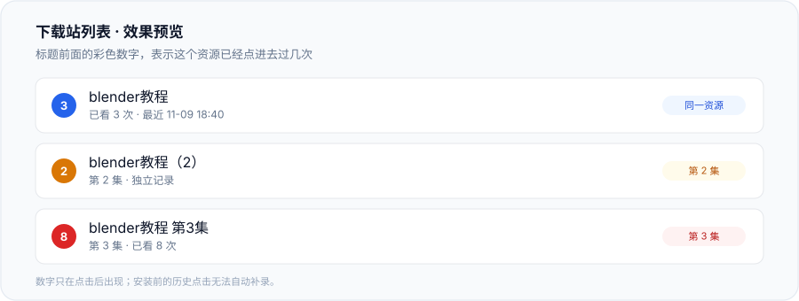

# 下载站重复点击提醒

在下载站标题前显示一个彩色数字，告诉你这个资源已经点进去过几次。

适合资源标题会被上传者加前缀、改后缀，但正文基本相同的下载站。脚本会尽量把同一个资源的标题归到一起，同时把 `（2）`、`第2集`、`第二季` 这类序号识别成不同集数，避免把系列的不同集误合并。



## 功能

- **链接前的彩色数字**：`1` 蓝色、`2–3` 橙色、`4+` 红色。
- **计数**：左键点击、中键新标签、`Ctrl/Cmd + 左键` 都会计数。
- **最近点击时间**：鼠标悬停数字查看首次/最近点击时间、站点和标题变体。
- **同一资源识别**：自动去掉 `[MP4/ 258M]`、`MP4`、`（中外文翻译）`、`1080P`、`中字`、大小、站点域名、上传者前后缀等装饰。
- **集数区分**：`（2）`、`第2集`、`02`、`（二）`、`EP2`、`blender教程2` 都会识别为 `ep:2`；`第二季`、`S01E02`、`全12集`、`1-12集`、日期等也分别处理。
- **保守合并**：只有去掉序号后的正文高度相似，并且差异只出现在开头/结尾、差异里没有数字和语义词时才合并。
- **站点限定**：只在指定域名或 URL 前缀下生效。
- **本地存储**：数据保存在 Tampermonkey 存储中，不发送到任何服务器。
- **管理菜单**：查看已记录资源、导出 JSON、清空记录、停用本站。
- **诊断工具**：检查当前页面识别到多少个标题链接。

## 安装

### 方式一：从 GitHub 安装

1. 安装 [Tampermonkey](https://www.tampermonkey.net/)。
2. 打开仓库里的 [`download-dedup.user.js`](./download-dedup.user.js)。
3. 点右上角 **Raw**，Tampermonkey 会弹出安装页，确认安装。

上传到 GitHub 后，Raw 地址通常是：

```text
https://raw.githubusercontent.com/<你的用户名>/<仓库名>/main/download-dedup.user.js
```

把 `<你的用户名>` 和 `<仓库名>` 换成实际值即可。

### 方式二：复制代码

1. 打开 `download-dedup.user.js`。
2. 全选复制。
3. Tampermonkey 管理面板 → 添加新脚本 → 粘贴 → `Ctrl+S` 保存。

## 启用站点

脚本的 `@match` 是 `*://*/*`，但**默认不会在任何网站生效**。需要先启用目标站点，三种方式任选：

### 1. 页面右下角提示

安装后第一次打开下载站，页面右下角会出现“本站还没有启用”的提示。点 **启用本站**，页面会自动刷新。

### 2. Tampermonkey 菜单

打开目标网站，点 Tampermonkey 图标：

- **▶ 启用“下载去重提醒”于本站**
- 页面刷新后生效。

### 3. 直接写进代码

编辑脚本顶部的 [`SITE_RULES`](./download-dedup.user.js)，加入域名：

```js
const SITE_RULES = {
  hostSuffixes: [
    'example.com',
    'another-site.net',
  ],
  urlPrefixes: [
    // 'https://www.example.com/forum/',
  ],
  titleSelectors: [
    // 'a.thread-title',
  ],
  excludeSelectors: [
    // '.sidebar a',
  ],
};
```

- `hostSuffixes`：写根域名，匹配该域名和所有子域名。不要带 `https://` 或路径。
- `urlPrefixes`：只启用某个板块时使用，必须带完整协议和路径。
- `titleSelectors`：站点标题链接识别不到时，填标题链接的 CSS 选择器。
- `excludeSelectors`：排除某些链接，例如侧边栏。

修改代码后刷新页面即可。

## 使用

1. 启用站点后，第一次点击某个标题。**点击前不会显示数字**，因为脚本没有历史记录。
2. 返回列表页，标题前就会出现数字。
3. 再次点击同一个资源，数字会增加。
4. 鼠标悬停数字可以看最近点击时间；点击数字可以打开详情、查看标题变体、打开最近链接或删除记录。

### 数字颜色

| 次数 | 颜色 |
| --- | --- |
| 1 次 | 蓝色 |
| 2–3 次 | 橙色 |
| 4 次及以上 | 红色 |

## 标题判定逻辑

1. **清洗装饰**：去掉格式、大小、清晰度、语言标签、站点域名、上传者标签等。
2. **提取序号**：从标题里提取 `ep`、`season`、`vol`、`part`、`range`、`pack`、`date`、`year` 等标记。
3. **标记必须一致**：`blender教程` 没有标记，`blender教程（2）` 有 `ep:2`，所以一定是两条记录。
4. **正文模糊匹配**：标记相同后，只有正文相似度足够高，并且多出来的文字只在开头/结尾、不含数字、不含“完整版/剧场版/从入门到精通”等语义词时才合并。

例如：

| 标题 | 清洗后 | 标记 | 结果 |
| --- | --- | --- | --- |
| `[MP4/ 258M] blender教程` | `blender教程` | 无 | 同一资源 |
| `MP4 blender教程` | `blender教程` | 无 | 同一资源 |
| `（中外文翻译） blender教程` | `blender教程` | 无 | 同一资源 |
| `blender教程` | `blender教程` | 无 | 同一资源 |
| `blender教程（2）` | `blender教程` | `ep:2` | 另一个资源 |
| `blender教程 第2集` | `blender教程` | `ep:2` | 与 `（2）` 同一条 |
| `blender教程 第二季` | `blender教程` | `season:2` | 另一个资源 |

## 数据与隐私

- 数据通过 `GM_getValue` / `GM_setValue` 保存在 Tampermonkey 本地存储中。
- 不发送网络请求，不收集账号、Cookie 或浏览记录。
- 不同浏览器、不同电脑之间不会自动同步。
- 可以在 Tampermonkey 菜单中导出 JSON 备份。
- 清空记录：Tampermonkey 菜单 → **🧹 清空全部记录**。

## 常见问题

### 安装了但页面没反应

1. 站点是否已启用？看右下角提示，或用 Tampermonkey 菜单启用。
2. 是否已经点过标题？第一次点击前不会有数字。
3. 点标题后是否回到了列表页？左键会跳转，需要返回；中键会在当前页更新。
4. 用 Tampermonkey 菜单 → **🔍 检查本页标题识别**，看识别到的标题数量。如果为 0，把页面网址和诊断内容发到 Issue。

### 有数字，但两个标题没有合并

默认策略是“宁可漏合并，也不把不同集合并”。如果两个标题差异较大，或者包含 `完整版`、`导演剪辑版`、`S01E02` 这类语义信息，脚本会保守地分开。

可以在 Issue 里给出两条真实标题，我会按你的站点规则调整。

### 两个不同资源被合并了

默认已经比较保守，但仍可能发生。可以：

- 点数字 → 删除这条记录；
- 或在 Issue 里给出两个标题和页面地址。

### 某些站的标题识别不到

给该站加 `titleSelectors`，例如：

```js
titleSelectors: [
  'a.thread-title',
  'h3 a[href*="/thread-"]',
],
```

### 页面上识别到的链接太多

把 `CONFIG.strictTitleDetection` 改成 `true`，只识别更像标题的链接：

```js
const CONFIG = {
  strictTitleDetection: true,
  // ...
};
```

### 右键“在新标签页打开”没有计数

按设计，只统计左键、中键和 `Ctrl/Cmd + 左键`。右键菜单打开的标签页不会被可靠捕获。

## 开发

这是一个单文件用户脚本，没有构建步骤。

```bash
npm run check
```

等价于：

```bash
node --check download-dedup.user.js
```

GitHub Actions 会在 push 和 pull request 时执行同样的语法检查。

## 目录结构

```text
.
├── .github/
│   ├── ISSUE_TEMPLATE/
│   └── workflows/check.yml
├── docs/
│   └── preview.svg
├── CHANGELOG.md
├── CONTRIBUTING.md
├── LICENSE
├── README.md
├── download-dedup.user.js
└── package.json
```

## License

[MIT](LICENSE)
